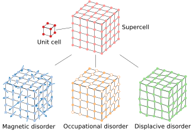
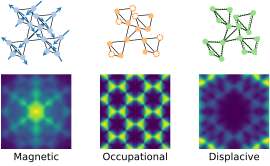
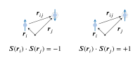
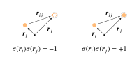
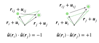
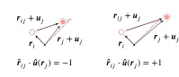

Background
==========

Reverse Monte Carlo refinement
------------------------------

To calculate the diffuse scattering intensity from a disordered structure,
a supercell is first generated from the average structure. Initially
random disorder is then introduced through magnetic moments, site
occupancies, and/or atomic displacements. The diffuse scattering intensity
is calculated from the *deviations* from the *average* structure.

   Generating a supercell with disorder.

The refinement follows the Metropolis algorithm. The cost is the reduced
chi-square goodness of fit between the calculated and the measured diffuse
scattering intensity

.. math::

   \chi^2_\nu=\frac{1}{\nu}\sum_{\boldsymbol{Q}}
   \left[\frac{sI_{\text{calc}}(\boldsymbol{Q})+b(\boldsymbol{Q})
   -I_{\text{expt}}(\boldsymbol{Q})}{\sigma_{\text{expt}}(\boldsymbol{Q})}\right]^2,

where the scale :math:`s` and the background :math:`b` (a constant, or a
piecewise linear function of :math:`|\boldsymbol{Q}|`) are fitted in
closed form after every move. Refined displacements add a penalty that
keeps each kind's displacement covariance at its ADP. A move that changes
the cost by :math:`\Delta` is accepted with probability

.. math::

   \alpha=\min\left(1, e^{-\Delta/T}\right),

so a worse move is still accepted at a rate set by the temperature
:math:`T`. The temperature is lowered by a constant factor after each round
of sweeps (one sweep is one move per atom). If no starting temperature is
given, it is calibrated so that a median uphill move is accepted with
probability one half; cost changes per move shrink as the supercell grows,
so a fixed starting temperature would not carry over between supercells.

Minibatches and held-out validation
-----------------------------------

The supercell's commensurate points in the measured volume can number in
the millions. Each few sweeps, the refinement draws a new random minibatch
from a training pool instead of using every point; this is faster and
keeps the configuration from adapting to the noise of a fixed set of points.

A fraction of the points is held out and never refined against. Every few
rounds the current configuration is scored on the held-out points, by
their reduced chi-square relative to that of the background alone (below 1
is better than no model), and the configuration with the best held-out
score is kept. Held-out sets can be stratified, e.g. into points on and off
diffuse features, so that each is judged on its own.

Diffuse scattering and correlated disorder
------------------------------------------

The diffuse scattering intensity of the supercell is updated after each
move. The intensity calculations are summarized below.

A system may be disordered by magnetic moments, site occupancies, or
atomic displacements. In general, the scattering intensity is either
magnetic or structural; the latter covers both occupational and displacive
disorder.

Magnetic
^^^^^^^^

The magnetic neutron scattering intensity is given by

.. math::

   I(\boldsymbol{Q})=\frac{C}{N}\left\langle\|\boldsymbol{F}_\perp(\boldsymbol{Q})\|^2\right\rangle,

where :math:`\boldsymbol{F}_\perp(\boldsymbol{Q})` is the component of
the vector structure factor perpendicular to :math:`\boldsymbol{Q}` and
:math:`C=0.07265` barn is a constant. The magnetic structure factor of a
system of magnetic moments :math:`\boldsymbol{M}_j` is

.. math::

   \boldsymbol{F}(\boldsymbol{Q})=\sum_{j}f_j(\boldsymbol{Q})\boldsymbol{M}_je^{i\boldsymbol{Q}\cdot\boldsymbol{r}_j},

where :math:`f_j(\boldsymbol{Q})` is the magnetic form factor. Positive
spin-pair correlations indicate ferromagnetic alignment and negative ones
antiferromagnetic alignment.

   Spin-pair correlations.

Structural
^^^^^^^^^^

The diffuse scattering intensity of structural disorder is the total
scattering intensity minus the Bragg intensity

.. math::

   I(\boldsymbol{Q})=\frac{1}{N}\left\langle\|F(\boldsymbol{Q})-\langle F(\boldsymbol{Q})\rangle\|^2\right\rangle,

where :math:`F(\boldsymbol{Q})` is the structure factor, built from the
scattering lengths :math:`b_j`. Structural disorder is due to occupational
and/or displacive disorder.

Occupational
""""""""""""

For partially occupied sites, the occupancy parameter

.. math::

   \delta_j=\begin{cases}
   1 & \text{occupied} \\
   0 & \text{unoccupied}
   \end{cases}

gives the local site occupancy, and the structure factor is

.. math::

   F(\boldsymbol{Q})=\sum_{j}b_j\delta_je^{i\boldsymbol{Q}\cdot\boldsymbol{r}_j}.

If each site has average composition :math:`c_j`, the relative occupancy
parameter

.. math::

   a_j=\frac{\delta_j}{c_j}-1

keeps the overall composition fixed, and the structure factor is

.. math::

   F(\boldsymbol{Q})=\sum_{j}b_jc_j(1+a_j)e^{i\boldsymbol{Q}\cdot\boldsymbol{r}_j}.

The two forms are related by :math:`\delta_j=c_j(1+a_j)`. Occupancy-pair
correlations use

.. math::

   \sigma_j=\begin{cases}
   +1 & \text{occupied} \\
   -1 & \text{unoccupied}
   \end{cases}.

Positive correlations indicate that two sites are both occupied or both
unoccupied; negative ones that one is occupied and the other is not.

   Occupancy-pair correlations.

Displacive
""""""""""

For atomic displacements :math:`\boldsymbol{u}_j`, the structure factor is

.. math::

   F(\boldsymbol{Q})=\sum_{j}b_je^{i\boldsymbol{Q}\cdot(\boldsymbol{r}_j+\boldsymbol{u}_j)}.

The phase factor of the displacement is approximated by a Taylor
expansion. Displacement-pair correlations are the dot products of the
normalized displacement vectors: positive values mean cooperative
displacements of the two sites, negative values anti-cooperative ones.

   Displacement-pair correlations.

Combined occupational-displacive
""""""""""""""""""""""""""""""""

With both site occupancies and atomic displacements, the structure factor
is

.. math::

   F(\boldsymbol{Q})=\sum_{j}b_j\delta_je^{i\boldsymbol{Q}\cdot(\boldsymbol{r}_j+\boldsymbol{u}_j)}

when the composition is free and

.. math::

   F(\boldsymbol{Q})=\sum_{j}b_jc_j(1+a_j)e^{i\boldsymbol{Q}\cdot(\boldsymbol{r}_j+\boldsymbol{u}_j)}

when it is fixed. Vacancy-displacement correlations relate the
displacement of an occupied site to a neighboring vacancy. They act as a
size-effect parameter: positive values mean displacements toward the
vacancy, negative values displacements away from it.

   Vacancy-displacement-pair correlations.

Conventions
-----------

In crystal coordinates, a real-space vector is

.. math::

   \boldsymbol{r}=u\boldsymbol{a}+v\boldsymbol{b}+w\boldsymbol{c}

and a reciprocal lattice vector is

.. math::

   \frac{\boldsymbol{Q}}{2\pi}=h\boldsymbol{a}^\ast+k\boldsymbol{b}^\ast+l\boldsymbol{c}^\ast.

The Cartesian axes follow the Busing-Levy convention, as in Mantid:
:math:`x` lies along :math:`\boldsymbol{a}^\ast`, :math:`y` is in the
plane of :math:`\boldsymbol{a}^\ast` and :math:`\boldsymbol{b}^\ast`,
and :math:`z` lies along :math:`\boldsymbol{c}`, so that
:math:`\boldsymbol{Q}=2\pi B\,(h,k,l)^\mathsf{T}`.
