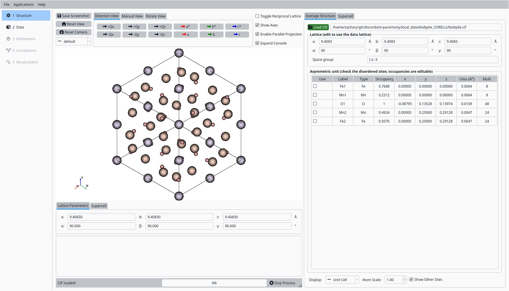
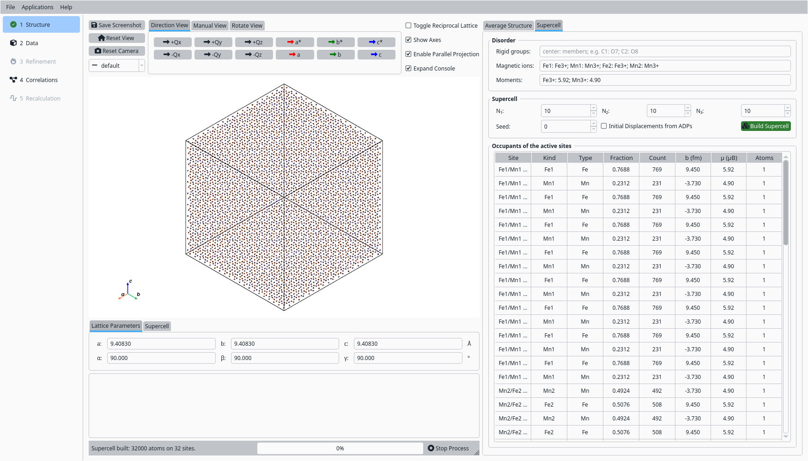
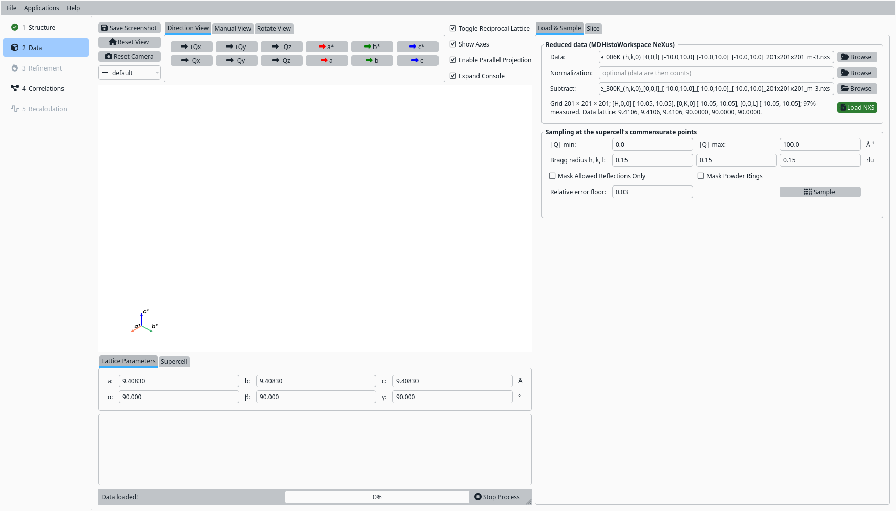
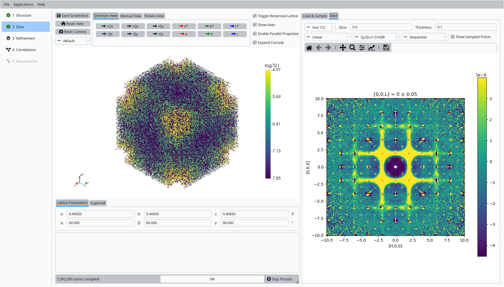
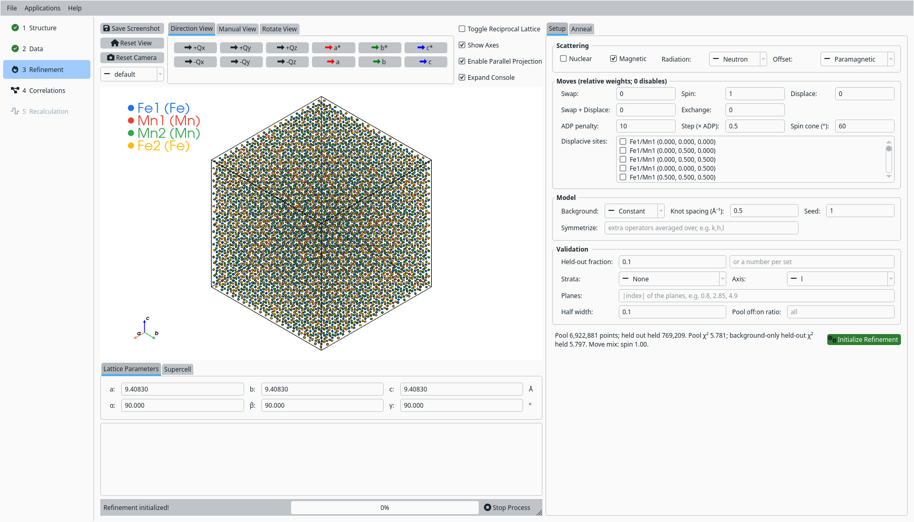
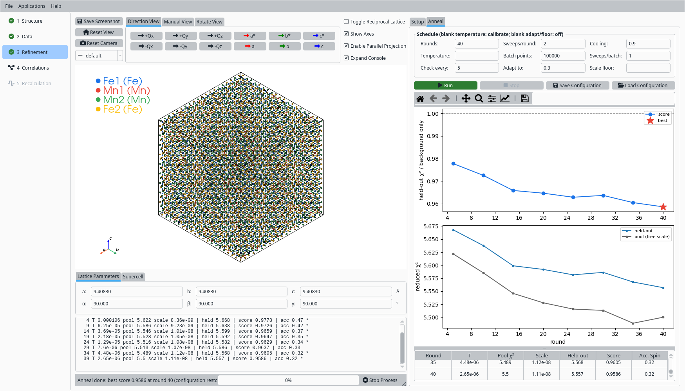
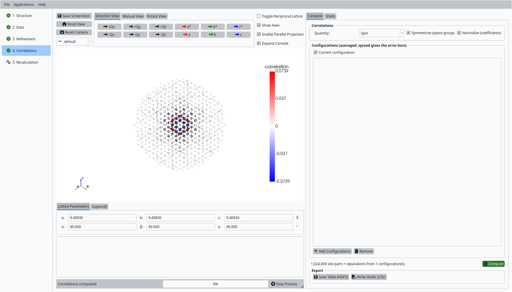
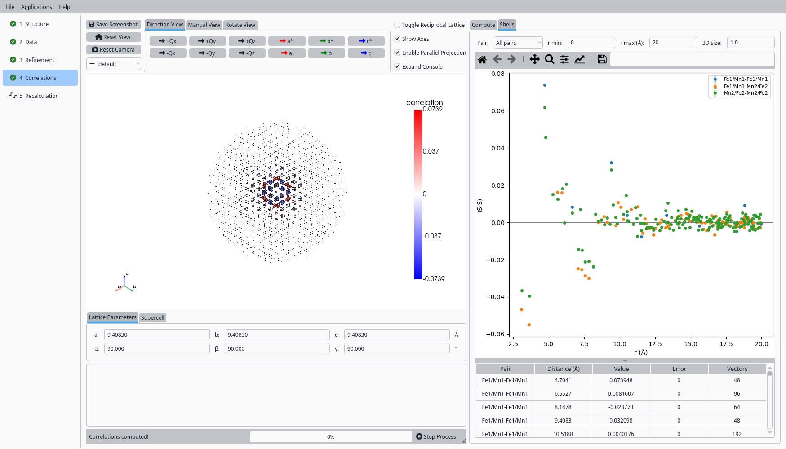
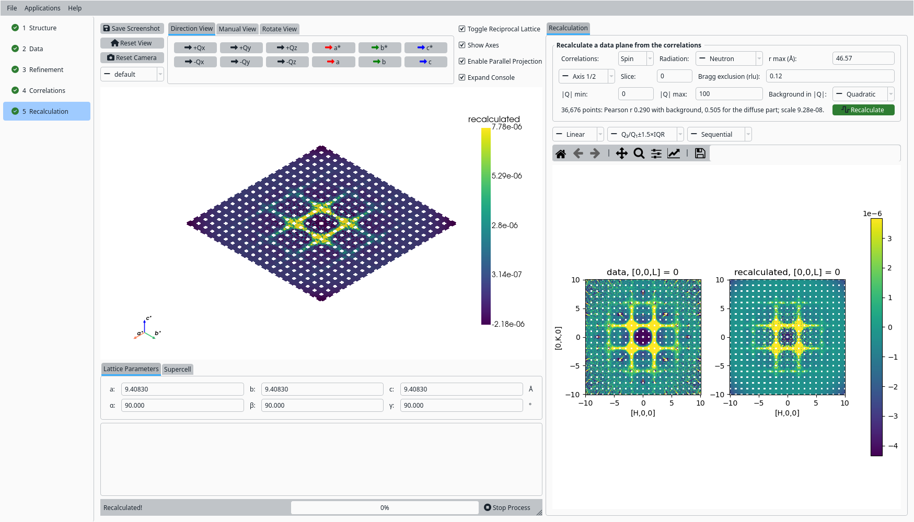

Magnetic Correlations with Bixbyite Data
========================================

This tutorial refines the short-range magnetic order of bixbyite,
:math:`\mathrm{(Fe,Mn)_2O_3}`, measured on CORELLI. The magnetic diffuse
scattering is isolated by subtracting a 300 K paramagnetic volume from a
6 K volume; the refinement rotates the spins of the Fe/Mn sites of a
:math:`10\times10\times10` supercell against the difference. The same
refinement without the interface is ``examples/bixbyite.py``.

Files (under ``bixbyite_CORELLI``):

- ``bixbyite.cif``: average structure, space group :math:`Ia\bar{3}`
- ``bixbyite_006K_...nxs``: 6 K volume, symmetrized in :math:`m\bar{3}`
- ``bixbyite_300K_...nxs``: 300 K volume, the paramagnetic reference

Step 1: Load the average structure
----------------------------------

In the **Structure** application, on the **Average Structure** tab:

- Click **Load CIF** and choose ``bixbyite.cif``.
- The lattice and space group fill in, and the table lists the
  asymmetric unit: Fe1/Mn1 share the :math:`8a` site and Mn2/Fe2 the
  :math:`24d` site, with their refined occupancies.
- The 3D view shows the unit cell. Sites not selected for disorder are
  drawn faded.

   Bixbyite unit cell loaded from the CIF.

Step 2: Build the supercell
---------------------------

- In the **Use** column, check **Fe1** and **Fe2**. Their sites become
  the disordered sites; Mn1 and Mn2, on the same positions, are included
  with them as the other occupants of each site.
- On the **Supercell** tab, enter the magnetic ions,
  ``Fe1: Fe3+; Mn1: Mn3+; Fe2: Fe3+; Mn2: Mn3+``, and the moments,
  ``Fe3+: 5.92; Mn3+: 4.90`` (:math:`\mu_\mathrm{B}`).
- Set :math:`N_1=N_2=N_3=10`, the seed to 0, and uncheck
  **Initial Displacements from ADPs**: only the spins are refined.
- Click **Build Supercell**. The occupant table lists each kind on each
  site with its fraction, scattering length, and moment.

   The :math:`10\times10\times10` supercell (32,000 atoms on the Fe/Mn
   sites).

.. note::

   The supercell size sets the reciprocal-space resolution: the model is
   evaluated on a grid of spacing :math:`1/N_i` along each axis. Start
   small and increase it if the diffuse features are not resolved; larger
   supercells take more memory and time.

Step 3: Load the data
---------------------

In the **Data** application, on the **Load & Sample** tab:

- Set **Data** to the 6 K volume and **Subtract** to the 300 K volume
  (no normalization is needed: both are already normalized).
- Click **Load NXS**. The grid, the range of each axis, and the measured
  fraction are reported.

   The 6 K - 300 K difference volume loaded.

Step 4: Sample at the commensurate points
-----------------------------------------

- The refinement compares the model with the data only at the
  supercell's commensurate points, :math:`\boldsymbol{h}=\boldsymbol{m}/N`.
- Set the **Bragg radius** to 0.15 r.l.u. along each axis to exclude the
  points near Bragg peaks, and the **Relative error floor** to 0.03, a
  systematic error added to the statistical one.
- Click **Sample**. The 3D view shows the sampled points, colored by
  intensity; the **Slice** tab shows a plane of the data, here
  :math:`(hk0)`, with **Show Sampled Points** marking the points used.

   Sampled points (left) and the :math:`(hk0)` plane of the difference
   (right).

Step 5: Set up the refinement
-----------------------------

In the **Refinement** application, on the **Setup** tab:

- Under **Scattering**, uncheck **Nuclear**, check **Magnetic**, and set
  **Offset** to **Paramagnetic**: the 300 K reference contains the
  paramagnetic scattering of uncorrelated spins, so the same term is
  subtracted from the calculated intensity before it is compared with the
  difference.
- Under **Moves**, give **Spin** weight 1 and the rest 0, with a
  **Spin cone** of 60°, the largest rotation of one move. No site is
  displacive.
- Under **Model**, use a **Constant** background.
- Under **Validation**, hold out a fraction of 0.1 of the points.
- Click **Initialize Refinement**. The pool and held-out sizes are
  reported with the chi-square of the background alone, the baseline the
  refinement has to beat.

   The refinement set up for spins only.

Step 6: Anneal
--------------

On the **Anneal** tab:

- Set 40 rounds of 2 sweeps, a cooling factor of 0.9 per round, and leave
  the **Temperature** blank to calibrate it.
- Use minibatches of 100,000 points, redrawn every sweep, and adapt the
  spin cone toward an acceptance of 0.3.
- Click **Run**. At every check, the upper plot shows the score, the
  held-out chi-square relative to that of the background alone, with the
  best check starred; the lower plot shows the reduced chi-square of the
  held-out and pool points. The table lists each check with the
  temperature, scale, and acceptance rates, and the console shows the log.
  **Stop** ends the anneal after the current round; the best
  configuration is kept.

   Annealing progress: held-out score below 1 means the spins fit better
   than no model.

Step 7: Spin-pair correlations
------------------------------

In the **Correlations** application:

- Choose **Spin** and click **Compute**. The correlations are averaged
  over the space group and normalized.
- The 3D view shows the correlation of each neighbor vector: red for
  ferromagnetic, blue for antiferromagnetic, sized by magnitude.

   Spin-pair correlations in three dimensions.

- The **Shells** tab plots the correlations against distance, for all
  pairs or one pair of sites, with the table of shells.

   Spin-pair correlations against distance.

Step 8: Recalculate the diffuse scattering
------------------------------------------

In the **Recalculation** application:

- Choose **Spin**, the :math:`(hk0)` plane (**Axis 1/2**, slice 0), and
  click **Recalculate**. The magnetic diffuse scattering is calculated
  from the correlations, out to the largest distance the supercell
  supports, and compared with the data in the same plane.

   Data (left) and recalculated (right) :math:`(hk0)` plane.
