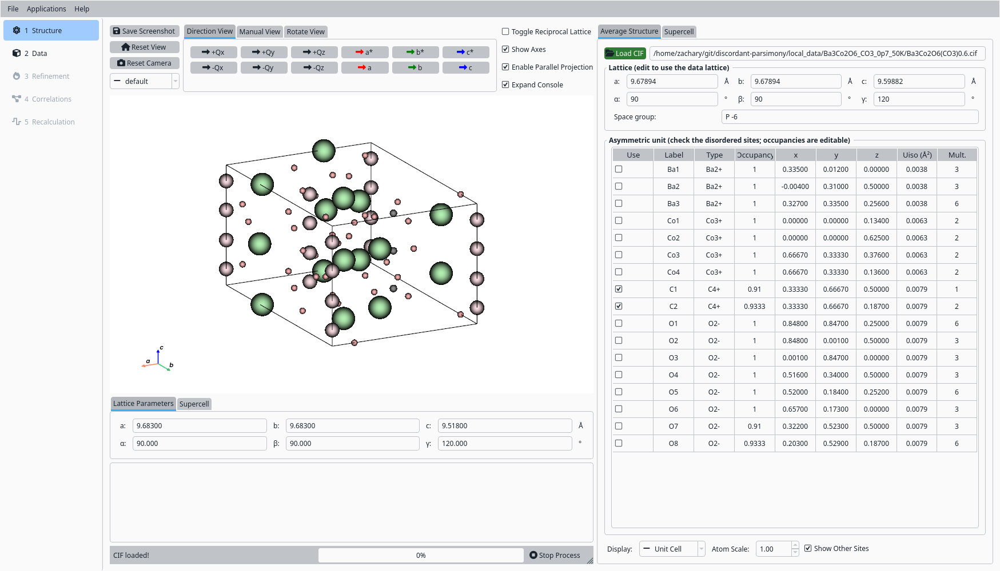
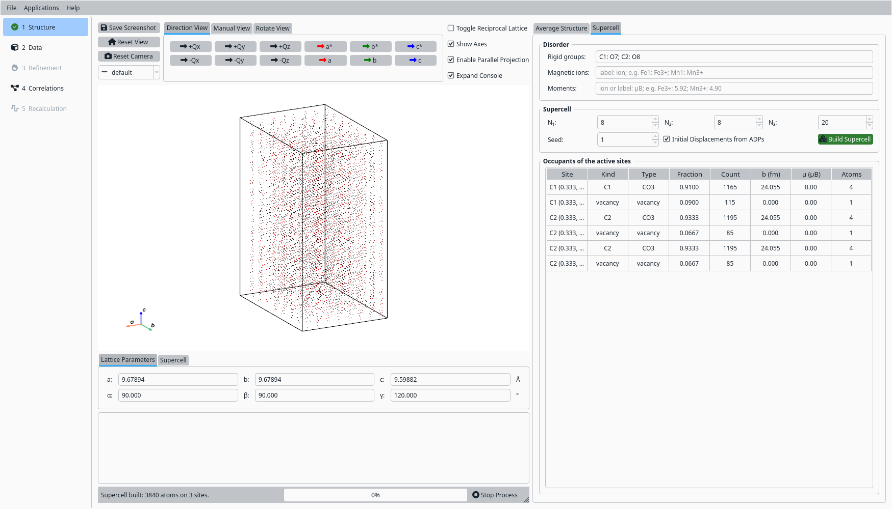
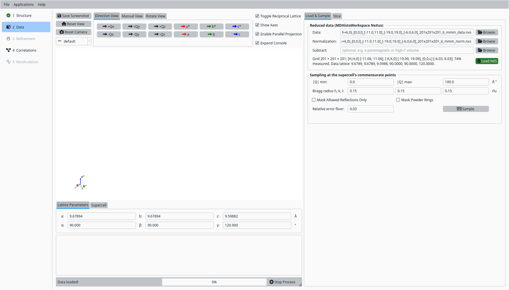
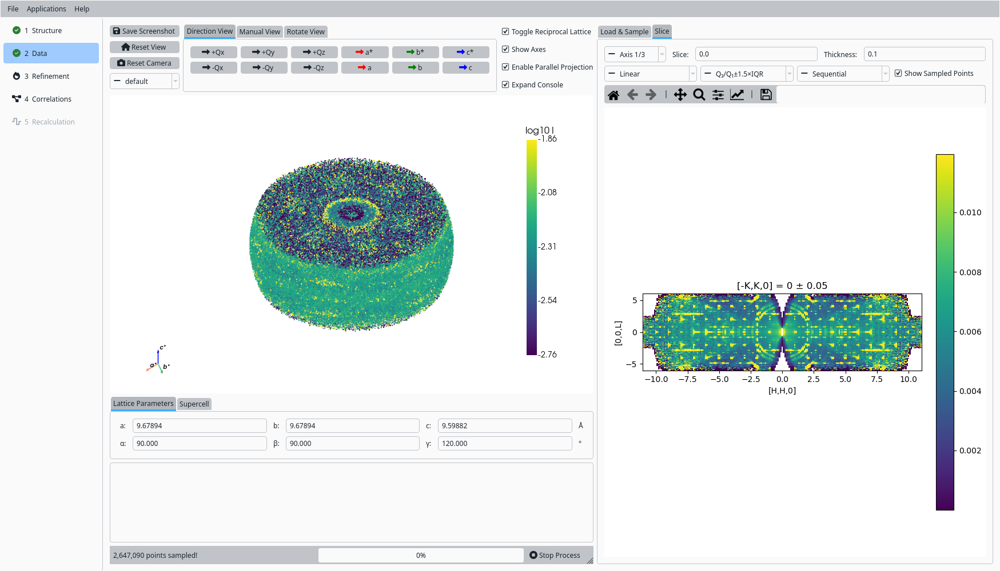
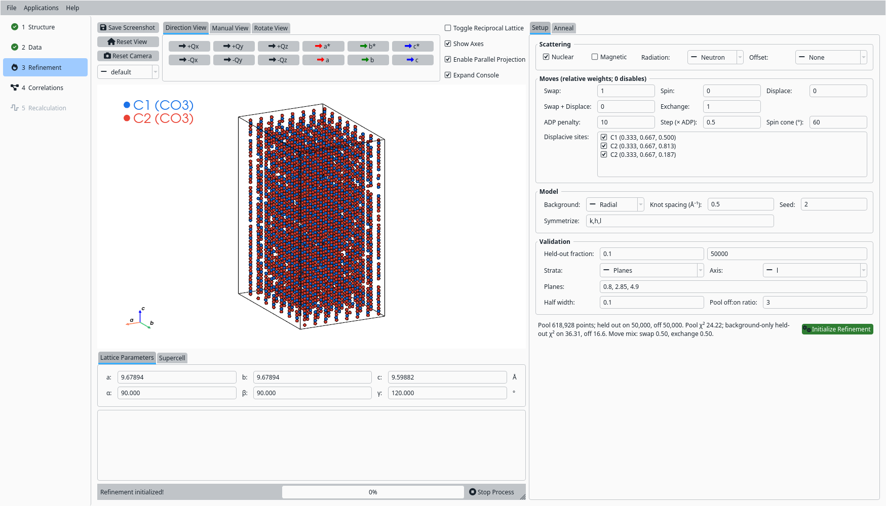
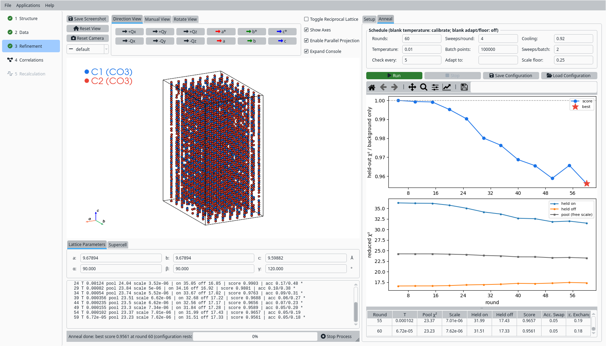
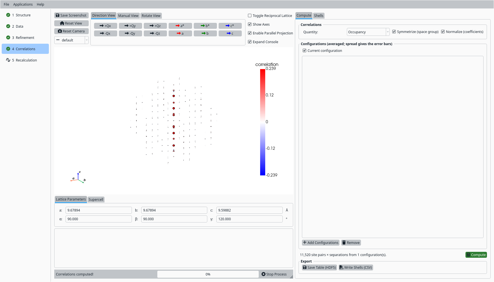
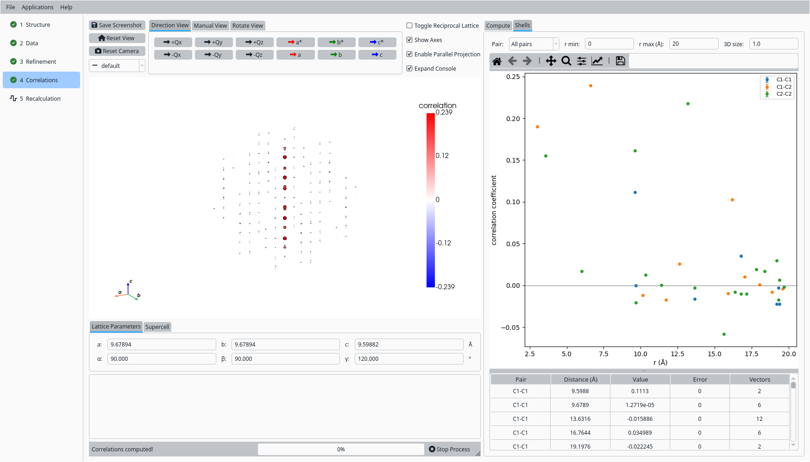
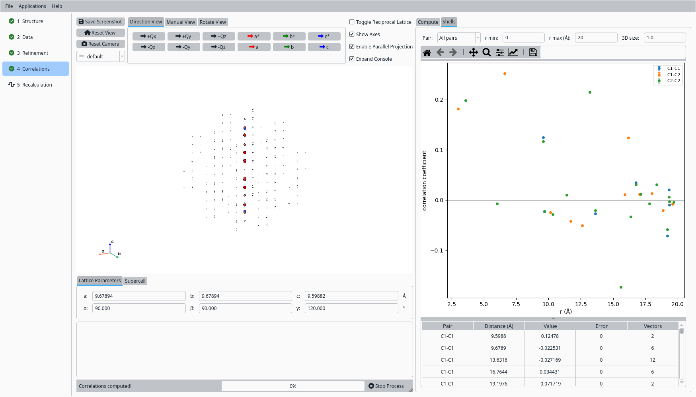
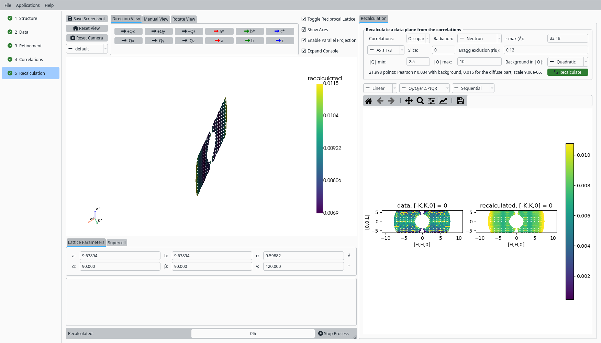

Carbonate Disorder with Ba3Co2O6(CO3)0.7 Data
=============================================

This tutorial refines the arrangement of carbonate groups in
:math:`\mathrm{Ba_3Co_2O_6(CO_3)_{0.7}}`, measured on CORELLI at 50 K.
The partially occupied carbonate sites order over short distances, giving
sheets of diffuse scattering at constant :math:`l`. The refinement swaps carbonates and vacancies on an
:math:`8\times8\times20` supercell and arranges their displacements, with
the displacement distribution held at the ADPs. The same refinement
without the interface is ``examples/co3.py``.

Files (under ``Ba3Co2O6_CO3_0p7_50K``):

- ``Ba3Co2O6(CO3)0.6.cif``: average structure
- ``..._data.nxs``: counts, symmetrized in :math:`6/mmm`
- ``..._norm.nxs``: the matching normalization

Step 1: Load the average structure
----------------------------------

In the **Structure** application, on the **Average Structure** tab:

- Click **Load CIF** and choose ``Ba3Co2O6(CO3)0.6.cif``.
- Replace the lattice with that of the data, :math:`a=b=9.67894` Å,
  :math:`c=9.59882` Å, :math:`\gamma=120^\circ`, so that the
  commensurate points fall on the data's grid (the lattice of a loaded
  volume is reported in the **Data** application).
- Check **C1** and **C2** in the **Use** column: their sites are the
  disordered ones.
- Scale the carbonate occupancies to the measured composition, 0.7
  instead of 0.6: C1 and O7 to 0.91, C2 and O8 to 0.9333.

   The average structure with the data lattice and scaled carbonate
   occupancies.

Step 2: Build the supercell
---------------------------

On the **Supercell** tab:

- Enter the rigid groups ``C1: O7; C2: O8``: each oxygen moves with its
  carbon, so a carbonate is present or absent as a whole.
- Set :math:`N_1=N_2=8`, :math:`N_3=20` (a finer grid along
  :math:`c^\ast`, across the sheets) and the seed to 1.
- Keep **Initial Displacements from ADPs** checked: each atom starts with
  a random displacement drawn from its ADP.
- Click **Build Supercell**.

   The :math:`8\times8\times20` supercell and the occupants of the
   carbonate sites.

Step 3: Load the data
---------------------

In the **Data** application, on the **Load & Sample** tab:

- Set **Data** to the ``_data.nxs`` file and **Normalization** to the
  ``_norm.nxs`` file. The data are then treated as counts: the bins
  combined at a commensurate point are summed before normalizing, which
  keeps bins with zero counts.
- Click **Load NXS**. The axes are :math:`[H,H,0]`, :math:`[-K,K,0]`, and
  :math:`[0,0,L]`.

   The normalized volume loaded.

Step 4: Sample at the commensurate points
-----------------------------------------

- Limit :math:`|Q|` to 2.5 - 10 Å\ :sup:`-1`.
- Set the **Bragg radius** to 0.15, 0.15, and 0.3 r.l.u. (wider along
  :math:`l`), uncheck **Mask Allowed Reflections Only** so that every
  integer point is masked, and check **Mask Powder Rings** to remove rings from the sample
  environment or polycrystalline contamination, found as shells of
  :math:`|Q|` whose median stands out from the radial profile.
- Set the **Relative error floor** to 0.03 and click **Sample**.
- On the **Slice** tab, **Axis 1/3** shows the :math:`(hhl)` plane, in
  which the diffuse sheets at :math:`|l|\approx0.8`, 2.85, and 4.9 are
  lines.

   Sampled points (left) and the :math:`(hhl)` plane (right).

Step 5: Set up the refinement
-----------------------------

In the **Refinement** application, on the **Setup** tab:

- Under **Scattering**, keep **Nuclear** only, with no offset.
- Under **Moves**, give **Swap** and **Exchange** weight 1 and the rest
  0. Swaps move carbonates between sites; exchanges swap the displacements
  of two atoms of the same site. Neither changes the set of displacements
  on a site, which stays at its ADP. Check every site as displacive, with
  an **ADP penalty** of 10.
- Under **Model**, use a **Radial** background with knots every
  0.5 Å\ :sup:`-1`, and **Symmetrize** over ``k,h,l``: the data were
  symmetrized in :math:`6/mmm`, which has a mirror the model's Laue class
  lacks, so the model is averaged over it too. Set the seed to 2.
- Under **Validation**, choose **Planes** strata along :math:`l` at
  ``0.8, 2.85, 4.9`` with a half width of 0.1, hold out 50,000 points of
  each set (on and off the sheets), and set the **Pool off:on ratio** to
  3, so that a quarter of the training pool lies on the sheets.
- Click **Initialize Refinement**.

   The refinement set up for carbonate swaps and displacement exchanges.

Step 6: Anneal
--------------

On the **Anneal** tab:

- Set 60 rounds of 4 sweeps, a cooling factor of 0.92, and a starting
  **Temperature** of 0.01.
- Use minibatches of 100,000 points redrawn every 2 sweeps, and a
  **Scale floor** of 0.25, which keeps the scale from collapsing during a
  round.
- Click **Run**. The held-out score is followed separately on and off
  the sheets.

   Annealing progress, with held-out sets on and off the sheets.

Step 7: Occupancy and displacement correlations
-----------------------------------------------

In the **Correlations** application:

- Choose **Occupancy** and click **Compute**. Positive correlations mean
  two sites that are both occupied or both empty; negative, one of each.

   Carbonate occupancy correlations in three dimensions.

- The **Shells** tab plots them against distance.

   Occupancy correlations against distance.

- Choose **Displacement** and compute again for the displacement-pair
  correlations.

   Displacement correlations against distance.

Step 8: Recalculate the diffuse scattering
------------------------------------------

In the **Recalculation** application:

- Choose **Occupancy**, the :math:`(hhl)` plane (**Axis 1/3**, slice 0),
  and the same :math:`|Q|` range, 2.5 - 10 Å\ :sup:`-1`, then click
  **Recalculate**.

   Data (left) and recalculated (right) :math:`(hhl)` plane.
